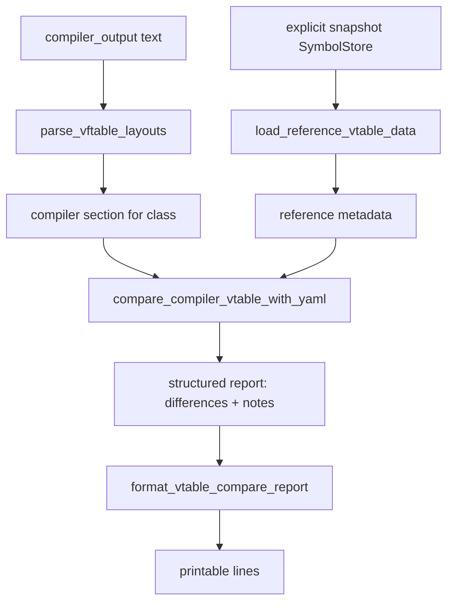

# cpp_tests_util

## Overview
`cpp_tests_util.py` provides reusable helpers for parsing clang vtable dumps and comparing them against reference metadata from an explicit snapshot `SymbolStore`. It is the core comparison engine used by the C++ test runner.

## Responsibilities
- Map target triples to YAML platform names (`windows` / `linux`).
- Parse `-fdump-vtable-layouts` compiler output into structured per-class entries.
- Load reference vtable metadata from module-prioritized entries in the explicit snapshot `SymbolStore`.
- Compare compiler-derived vtable structure against YAML expectations.
- Produce human-readable report lines from structured comparison output.

## Involved Files (no line numbers)
- cpp_tests_util.py
- run_cpp_tests.py
- configs/<GAMEVER>.yaml
- gamesymbol_store.py / explicit Release-local snapshot candidate derived from `bin_artifacts`

## Architecture
High-level flow:

Key function interactions:
- `compare_compiler_vtable_with_yaml` orchestrates parsing + reference loading + diff generation.
- `parse_vftable_layouts` relies on `VFTABLE_HEADER_RE` / `VFTABLE_ENTRY_RE` and `_extract_member_name`.
- `load_reference_vtable_data` queries the provided `SymbolStore` and uses `_parse_int_maybe` plus `_normalize_reference_member_name`.
- `format_vtable_compare_report` renders report dicts for CLI output.

## Dependencies
- Python stdlib: `re`, `pathlib.Path`, `typing`.
- Internal store contract: `gamesymbol_store.SymbolStore`; the CLI opens an explicit canonical snapshot candidate derived from tracked `bin_artifacts`.
- Input contracts:
  - clang output produced with `-fdump-vtable-layouts`.
  - YAML fields such as `vtable_size`, `vtable_numvfunc`, `vfunc_index`, `func_name`.

## Notes
- `map_target_triple_to_platform` currently maps:
  - `x86_64-pc-windows-msvc` -> `windows`
  - `x86_64-pc-windows-gnu` -> `linux`
  - `x86_64-*-linux-gnu` -> `linux`
  Unmatched triples return `None`.
- `pointer_size_from_target_triple` currently always returns `8` (even fallback path), so non-64-bit targets are not differentiated.
- `parse_vftable_layouts` bounds sections by raw entry count, validates complete-layout raw indices, and normalizes only the primary table. Itanium `Vtable for` includes inherited slots and secondary subobject tables; RTTI identifies the address point and subsequent ABI metadata ends the primary table. MSVC emits separate `VFTable for` sections; when multiple tables exist, vfptr-zero method locations must identify one uniquely.
- Indices-only, truncated, malformed, or ambiguous dumps produce `compiler_layout_incomplete`. They cannot establish total size or prove that an unobserved inherited slot is absent. Known method names and reference conflicts remain checked.
- `load_reference_vtable_data` respects module priority order and returns the first module that yields vtable metadata; within a module, later files can overwrite the same `vfunc_index` entry.
- Name mismatch checks require both expected and actual member names to be non-empty; missing name tokens do not produce `vfunc_name_mismatch`.
- Comparison currently checks reference-defined indices only; extra compiler indices beyond reference are not flagged as dedicated differences.

## Callers (optional)
- `run_cpp_tests.py` imports and uses:
  - `map_target_triple_to_platform`
  - `pointer_size_from_target_triple`
  - `compare_compiler_vtable_with_yaml`
  - `format_vtable_compare_report`

## Experience: inherited slots and primary-table boundaries (#1083)
- Trigger: inherited classes report too few slots or missing low indices; enabling Linux complete layouts then overcounts multiple inheritance.
- Root cause: `VTable indices for` is partial method-location evidence, while `Vtable for` is an Itanium table group. Neither the number of introduced methods nor the largest subobject table identifies the complete primary vtable.
- Correct approach: validate raw dump structure, strip ABI metadata relative to the primary address point, isolate secondary tables, and fail explicitly when complete primary-layout evidence is unavailable. Preserve separate complete/deleting destructor slots on Itanium.
- Verification: `uv run python -m unittest tests.test_run_cpp_tests` includes real Clang Linux/MSVC dumps and synthetic malformed/ambiguous cases; run the snapshot-backed `run_cpp_tests.py` separately to expose real SDK/reference differences.
- Scope: Clang vtable parsing and comparison only. Header order, conflicting reference YAML, and record-member offsets require separate root-cause analysis.

## Experience: analyzed names and interface boundaries (14191b)
- Trigger: s2sdk migration compiles but snapshot-backed ABI comparisons report name differences, a missing CEntitySystem member, or Linux table lengths 104/53 versus SDK 103/52.
- Root cause: some legacy artifact labels describe different semantics; m_bAutoExecuteQueuedDeletion already occupies 0xc63; concrete CSource2Server/CNetworkServerService append methods beyond ISource2Server/INetworkServerService.
- Correct approach: verify function bodies, profiler strings and RTTI in the matching binary/IDB before changing names. Retain legacy artifact keys while correcting payload func_name/member_name; preserve addresses, signatures, offsets, slots, binary locks and concrete table contents. Use cpp_tests.interface_vtable_numvfunc only with an independently verified interface boundary. It enforces exact compiler size/count, consistent concrete metadata, ownership and known slots; it cannot be combined with allow_vtable_size_mismatch.
- Verification: test malformed counts, incomplete/inconsistent evidence and real slot/count mismatches, then build a new immutable snapshot and run complete Windows/Linux run_cpp_tests.py --platform comparisons. Do not change SDK declarations solely to match old names or concrete-only tail slots.
- Scope and evidence: docs/cpp-abi-reference-validation.md records the 14191b binary addresses, canonical spellings and interface table boundaries. Earlier GAMEVER artifacts and historical snapshots retain their own metadata.
